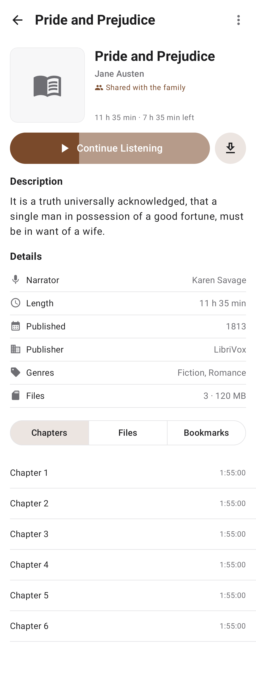

# A book's page
{: .no_toc }

Tap a book anywhere in the app to open its page.

1. TOC
{:toc}

{: width="300"}

## At the top

The cover, title, subtitle and author. Below them:

- the series the book belongs to, with its number ("The Expanse #3"); tap it to open the series,
- **Shared with the family** for a book shared in your own.audio family,
- the length, with the time left once you have started ("11 h 35 min · 7 h 35 min left"), or
  **Finished**.

## Play and download

The wide button plays the book. Its label says what it will do: **Play**, **Continue
Listening**, **Listen Again** for a finished book, or **Pause** / **Resume** for the book that is
playing. The button's fill is also a progress bar: the darker part is how far you are.

The round button beside it downloads the book. While it downloads it shows how far it got; once
done, a tap asks **Remove Download?**. If a download failed, a tap tries again.

## Description and details

**Description** shows the server's description of the book; **Show more** opens the rest.
**Details** lists what the server knows: **Narrator**, **Length**, **Published**,
**Publisher**, **Genres** and **Files** (how many, and their size).

## Chapters, Files, Bookmarks

The switch at the bottom shows one of three lists. A tap on any row plays the book from there.

- **Chapters**: each chapter with its length; the one playing is marked. If the server has no
  chapters for the book, the app reads the chapter marks from the audio files themselves.
  A book with no marks at all says "No chapter marks. The files are the chapters."
- **Files**: the book's audio files in order, with their lengths.
- **Bookmarks**: the bookmarks you made in the [player](player.md#bookmarks).

## The book's menu

The **⋮** button at the top right has:

| Item | What it does | Where |
|---|---|---|
| **Add to Favorites** / **Remove Favorite** | Marks the book with a heart. Favorites can be shown with the library's **Show** filter. | own.audio |
| **Share with the Family** / **Keep to Myself** | Shares a book you added with everyone in your family, or takes it back. Shown only for your own books. | own.audio |
| **Mark as Finished** / **Mark as Not Finished** | Sets the book finished or not, on the server too. | Both |
| **Reset Progress** | After asking, forgets your position in the book on every device. | Both, once you have started the book |
