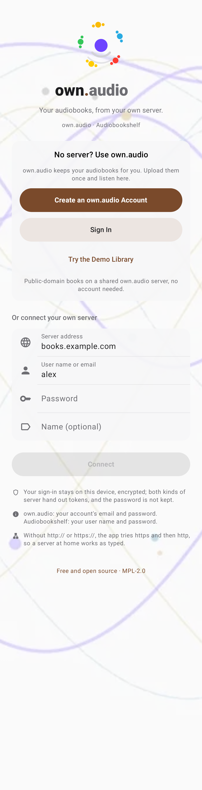

# Getting started
{: .no_toc }

The first time you open the app, it asks for one thing: a server. Make an own.audio account,
add a server of your own, or try the app with the public demo library first.

1. TOC
{:toc}

## The first screen

{: width="300"}

The first screen offers two ways in: an account on own.audio's hosted service, or a server of
your own.

### No server? Use own.audio

The card at the top is for someone without a server. own.audio keeps your audiobooks for you.

- **Create an own.audio Account**: fill in **Your Name**, **Email** and a **Password** of at
  least 12 characters (a few words are fine), then tap **Create Account**. The app signs in to
  the new account straight away. own.audio emails you a link to confirm the address. In the
  Google Play build, **Continue with Google** at the top makes the account with your Google
  account instead.
- **Sign In**: for an account you already have, with your **Email** and **Password**, or
  **Continue with Google** in the Google Play build.
- **Try the Demo Library** signs in to a shared own.audio server with public-domain books, with
  no account needed. The server is called **own.audio demo** in the app. Remove it in Settings
  when you add your own.

Both screens always go to own.audio's hosted service. For another own.audio server, use the
server form below.

## Adding your server

Under **Or connect your own server**, fill in:

| Field | What goes in it |
|---|---|
| **Server address** | Your server's address, for example `books.example.com` or `192.168.1.20:13378`. |
| **User name or email** | own.audio: your account's email. Audiobookshelf: your user name. |
| **Password** | Your password on that server. |
| **Name (optional)** | What the app calls the server. Leave it empty to use the server's own name. |

Then tap **Connect**. The app finds out by itself whether the address is an own.audio or an
Audiobookshelf server, and saves the server only once the sign-in works.

If you type the address without `http://` or `https://`, the app tries https first and then
http, so a server at home works as you typed it.

Your sign-in stays on the phone, in a file encrypted with a key kept in Android's Keystore.
Both kinds of server give the app a sign-in token, and the app doesn't keep your password.

On Audiobookshelf the app shows book libraries only. If your account reaches none, it says
"This account reaches no book library on that server."

## Sign in with Google (own.audio)

In the Google Play build, when the address you typed is an own.audio server that offers it, a
**Continue with Google** button appears under **Connect**, with the note "With your own.audio
account." It never appears for an Audiobookshelf address, and the F-Droid build has no Google
sign-in. Android's account picker opens, and the app passes the result to your server.

## Two-factor codes (own.audio)

If your own.audio account has two-factor sign-in turned on, a **Two-Factor Sign-In** screen
opens after **Connect**. Type the code from your authenticator app, or one of your recovery
codes, and tap **Sign In**.

## Adding more servers

You can add as many servers as you like, own.audio and Audiobookshelf mixed. Open
**Settings** (the gear at the top of [Home](home.md)) and tap **Add a Server** under
**Servers**. The **Add Server** screen has the same fields and buttons as the first screen.

The library shows one server at a time: the selected one, with a checkmark in the list of
servers. To switch, use the server menu at the top of Home, or tap **Use This Server** on a
server's page. A book that is playing keeps playing when you switch.

## The tabs

Once a server is added, the app has four tabs at the bottom:

- **Home**: what you were listening to, and the server's shelves. See [Home](home.md).
- **Library**: every book, and ways in by series, author, narrator and collection. See
  [Library and search](library.md).
- **Downloads**: what is on this phone, from every server. See
  [Downloads and offline](downloads.md).
- **Search**: books, authors, narrators and series. See [Library and search](library.md#search).
