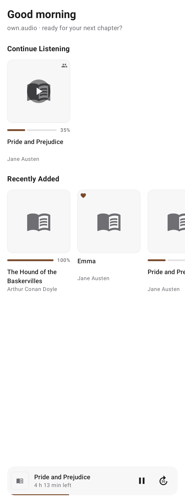

# Home
{: .no_toc }

The app opens on **Home**: a greeting, the selected server's name ("own.audio · ready for your
next chapter?"), and the server's shelves.

1. TOC
{:toc}

{: width="300"}

## The shelves

Each shelf scrolls sideways. Which shelves you see depends on the server:

- **own.audio**: **Continue Listening** (books you have started, the most recent first),
  **Recently Added** and **Listen Again** (books you have finished).
- **Audiobookshelf**: the shelves your server arranges for you, with the names it gives them.

On **Continue Listening**, a tap on a cover plays the book straight away, from where you left
off. To open the book's page instead, touch and hold the cover and choose **Show Book**. On the
other shelves, a tap opens the book's page, the series or the author.

The covers carry small badges:

- a progress bar with the percentage under a book you have started,
- a people icon in the top right corner for a book shared with your family (own.audio),
- a heart in the top left corner for a favorite (own.audio),
- a download mark for a book on this phone.

Pull down to reload the shelves.

When the app is offline, Home shows only what is on this phone: **Continue Listening** with
the downloaded books you have started, and **On This Device** with every downloaded book.

## The buttons at the top

- **Server menu**: appears when you have more than one server, or an Audiobookshelf account
  with more than one book library. It switches what Home and the Library show.
- **Offline Mode** (the Wi-Fi symbol): turns offline mode on or off. See
  [Downloads and offline](downloads.md#offline-mode).
- **Settings** (the gear): opens [Settings](settings.md).

## The mini player

While a book plays, a bar sits above the tabs on every screen: the cover, the title, and the
time left at the current speed. Its buttons are play/pause and skip forward. A thin line along
its bottom edge shows how far into the book you are. Tap the bar to open the full
[player](player.md).

After the app has been closed, the bar shows the book you were last listening to, with a play
button. Tap it to go on from where you left off.

## "Continue from another device?"

On own.audio, the server remembers where each of your devices left off. If you start a book on
this phone and another device of yours has got noticeably further (or less far) since, the app
asks which place to use, for example:

- **Continue from Tablet (1:02:07)**
- **Keep this device's position (48:10)**

Audiobookshelf keeps one position per book; the app starts from the newer one without asking.
