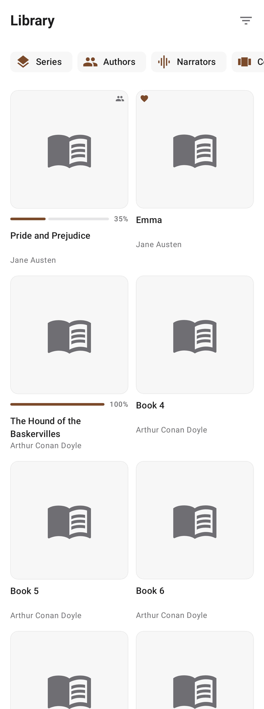
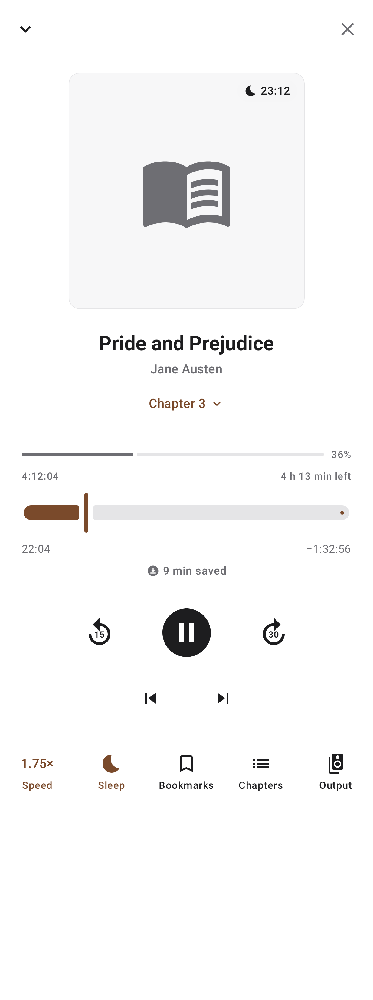
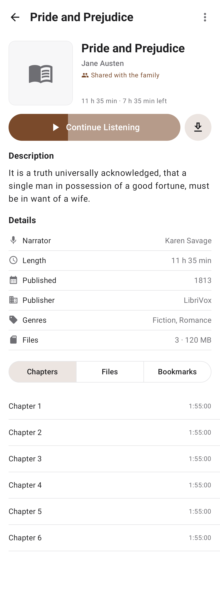

# own.audio Books for Android

own.audio Books is an audiobook player for Android phones that plays from your own server. It
works with two kinds of server, side by side in one app:

- **Audiobookshelf**, the self-hosted audiobook server.
- **own.audio**, either a server you run yourself or the hosted service at
  [own.audio](https://www.own.audio).

The app has no account of its own and keeps no library of its own: it shows what is on the
servers you add. It is free, has no in-app purchases and no ads, and runs on Android 9 and
later. On the home screen it is called **own.book**.

## Getting the app

own.audio Books for Android is **not yet on Google Play**. An F-Droid build is coming too.
The two builds are the same app, with one difference: the Google Play build can sign in to an
own.audio server with your Google account, and the F-Droid build has no Google code at all. Sign
in with Apple is in both.

{: width="180"}
{: width="180"}
{: width="180"}

## What the two servers offer

The app asks each server what it can do and hides what the server doesn't have, so some
buttons only appear on one kind of server.

| Feature | own.audio | Audiobookshelf |
|---|---|---|
| Playing, chapters, speed, sleep timer | Yes | Yes |
| Bookmarks | Yes | Yes |
| Positions shared with your other devices | Yes | Yes |
| Asks which position to use when another device is ahead | Yes | No |
| Series, authors, narrators | Yes | Yes |
| Collections | Yes | Yes |
| Favorites | Yes | No |
| Several book libraries in one account | No | Yes |
| Smaller stream on mobile data (**Saver**) | Yes | Yes |
| Whole library browsable offline | Yes | No |
| Library updates within seconds of a change on the server | Yes | No |
| Adding books from this phone | Yes | No |
| Family library and sharing | Yes | No |
| Signed-in devices, listening statistics | Yes | No |
| Sign in with Apple or Google, two-factor codes | Yes, if the server offers them (Google: Google Play build only) | No |

## The guide

- [Getting started](getting-started.md): the first screen, the demo library, signing in, adding a server.
- [Home](home.md): Continue Listening, the shelves and the mini player.
- [Library and search](library.md): all books, series, authors, narrators, collections.
- [A book's page](book.md): play, download, chapters, files, bookmarks, the book's menu.
- [The player](player.md): speed, skip buttons, smart rewind, chapters, bookmarks, sleep timer.
- [Downloads and offline](downloads.md): downloading, storage, offline mode, mobile data.
- [Adding books](importing.md): importing audio files to an own.audio server.
- [Servers and family](servers.md): a server's page, addresses, family, devices and listening.
- [Settings](settings.md): every setting, what it does and its default.
- [Android Auto, the widget and the notification](system.md): the app outside the app.
- [Privacy](privacy.md): what the app sends, and to whom.
- [Troubleshooting](troubleshooting.md): signing in again, the log, common problems.

## Links

- [Privacy policy](https://github.com/own-audio/book-android/blob/main/PRIVACY.md)
- [Report a problem or ask a question](https://github.com/own-audio/book-android/issues)
- [Source code](https://github.com/own-audio/book-android) (MPL-2.0)

The app is in English and Czech. It follows your phone's language, or the one you pick under
**Language** in [Settings](settings.md#language).
