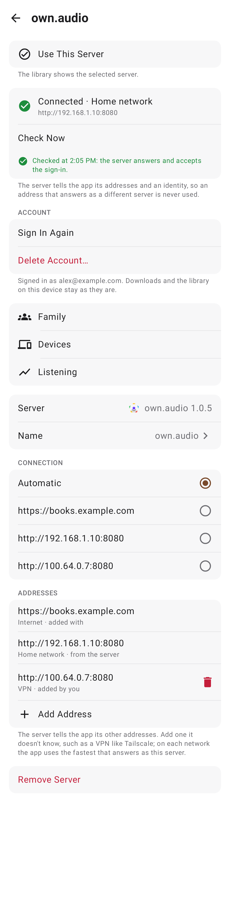

# Servers and family
{: .no_toc }

1. TOC
{:toc}

## Your servers

Your servers are listed at the top of [Settings](settings.md), under **Servers**. Each row shows
the server's name, its kind (own.audio or Audiobookshelf) and your account. The selected server,
the one the library shows, has a checkmark. If a server refused your sign-in, the row says
**Sign-in refused · Sign in again** in red.

Tap a server to open its page. To remove it, swipe it to the left or open its **⋮** menu.

## A server's page

{: width="300"}

From the top:

- **Use This Server**: makes it the one the library shows.
- The status, for example **Connected · Home network** with the address in use, and **Check
  Now**, which asks the server again and says what it found: it answers and accepts the
  sign-in, it refuses the sign-in, or no address answers.
- **Account**: **Sign In Again** (see below). On own.audio also **Delete Account…**.
- **Family**, **Devices** and **Listening** (own.audio, see below).
- **Server** (its kind and version) and **Name**. Tap **Name** to rename the server in the app.
- **Library** (Audiobookshelf): when your account has several book libraries, choose which one
  the app shows. Each is also in the server menu on Home.
- **Connection** and **Addresses** (below).
- **Remove Server**.

## Addresses

A server can have more than one address: one at home, one from outside, one through a VPN such
as Tailscale. On each network the app uses the fastest one that answers, and only if it answers
as the same server.

- On **own.audio**, the server tells the app its other addresses.
- On **Audiobookshelf**, add them yourself.

Under **Addresses**, each address says where it reaches the server (**Home network**, **VPN** or
**Internet**) and where it came from: **added with** (the address you signed in with), **from
the server** or **added by you**. **Add Address** adds one, such as
`http://192.168.1.20:13378`. The bin icon removes an address you added.

Under **Connection**, **Automatic** (the default) lets the app choose; pick an address to always
use that one.

## Sign In Again

When a server refuses the app's sign-in (for example after you changed your password), open
the server's page and tap **Sign In Again**. Type your password and tap **Sign In**. If you
signed up with Apple or Google, sign in the same way (Google: Google Play build only). Downloads and the library on
this phone stay as they are.

## Delete Account (own.audio)

**Delete Account…** deletes your account on that own.audio server for good, after asking for
your password, with everything you added to it: music, audiobooks, podcasts, playlists and your
listening history. What others in your family added stays with them. An account that signs in
with Apple or Google leaves the password empty. Audiobookshelf accounts are made and removed by the
server's admin, so there is no such button for them.

## Removing a server

**Remove Server** removes the server from the app, after asking. Its downloads leave this
phone. Nothing changes on the server.

## Family (own.audio)

An own.audio account belongs to a family. Each member has their own books and positions, and
chooses which of their books to share with the others. Audiobookshelf has no families, so none
of this appears for an Audiobookshelf server.

To share one of your books, open its page, tap **⋮** and choose **Share with the Family**.
Everyone in the family can then listen to it, each from their own position. **Keep to Myself**
takes it back. Shared books have a people badge on their covers, and **Shared with the family**
on their page.

**Family**, on the server's page, shows:

- **Members**: everyone in the family, with **Admin** for the family's admin and **Invited**
  for someone who hasn't joined yet.
- **Storage**: how much the family's library takes, split into **Audiobooks**, **Music** and
  **Podcasts** (own.audio also has music and podcast apps).
- **Credit**: on a server that charges for storage, the family's **Balance**, **A Month at
  Today's Storage** and how long the credit **Lasts About**. Storage is paid from the family's
  prepaid credit, day by day; top-ups are not made in the app.
- **Invitations** (the admin only): **Invite Someone** makes a code for one person, shown with
  a QR code and a **Share Invitation** button. They sign in to the same server and enter the
  code, or open its link. **Withdraw**, in an invitation's menu, cancels it.
- **Join Another Family…**: enter a code from another family's admin. You then leave this
  family, and what the other family shares appears instead.

## Devices (own.audio)

**Devices** lists every device signed in to your account, with **This device** marked and when
each was last used. Open a device's menu to **Sign Out** of it. **Sign Out Everywhere** ends
every session, this device's too, and you sign in again.

## Listening (own.audio)

**Listening** shows what you have listened to in all own.audio apps signed in to the account:
choose **Week**, **Month**, **Year** or **All**.

- **Listened** (total time), **Days in a Row** and **Audiobooks Finished**
- a chart of minutes per day
- **By Kind**: audiobooks, music, podcasts
- **Most Played**

**Share with the Family's Admin** lets the admin see how long you listen, and to what kind; off,
your listening stays yours. The admin sees a **Family** section with the time of those who
share it, and **Not Shared** for the others.
