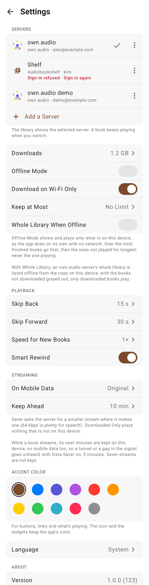

# Settings
{: .no_toc }

Open Settings with the gear at the top of [Home](home.md). Settings is a page of its own; the
back arrow at the top left, or Android's back gesture, takes you back.

1. TOC
{:toc}

{: width="300"}

## Servers

Your servers and **Add a Server**. See [Servers and family](servers.md).

## Downloads and offline

| Setting | What it does | Default |
|---|---|---|
| **Downloads** | Opens the list of downloaded books; shows their total size. | |
| **Offline Mode** | Shows and plays only what is on this phone, and asks nothing of the servers. | Off |
| **Download on Wi-Fi Only** | Downloads wait for Wi-Fi. | On |
| **Keep at Most** | A limit for downloads: **No Limit**, 1 GB, 2 GB, 5 GB or 10 GB. Over it, finished books go first, then the ones not played for longest; never the one playing. | No Limit |
| **Whole Library When Offline** | Offline, an own.audio server's whole library is listed from the copy on this phone, with books not downloaded grayed out. Only downloaded books play. Shown only when you have an own.audio server. | Off |

More in [Downloads and offline](downloads.md).

## Playback

| Setting | What it does | Default |
|---|---|---|
| **Skip Back** | How far the skip back button goes: 5, 10, 15, 30, 45, 60 or 90 s. Also in the notification and in the car. | 15 s |
| **Skip Forward** | How far the skip forward button goes, same choices. | 30 s |
| **Speed for New Books** | The speed a book starts at the first time: 0.75× to 2×. After that each book keeps its own speed. | 1× |
| **Smart Rewind** | Goes back a few seconds when you resume after a pause, more after a longer one. See [the player](player.md#smart-rewind). | On |

On own.audio, the skip intervals and the speed for new books are saved to your account, so they
follow you to the other own.audio apps you sign in to.

## Streaming

| Setting | What it does | Default |
|---|---|---|
| **On Mobile Data** | **Original** streams the original files. **Saver** asks the server for a smaller stream (64 kbps) where it makes one. **Downloaded Only** plays nothing that is not on this phone. | Original |
| **Keep Ahead** | While a book streams, how many minutes ahead are kept on the phone, so a gap in the signal goes unheard: 5, 10 or 15 min. With Data Saver on, 5 minutes. Saver streams are not kept. | 10 min |

## Accent Color

A row of colors for buttons, links and what's playing: **App Color** (the app's brown, the
default), **Blue**, **Indigo**, **Purple**, **Red**, **Orange**, **Yellow**, **Green**,
**Teal**, **Pink** and **Graphite**. The app icon and the widget keep the app's color.

The app follows your phone's light or dark theme.

## Language

**System** (the default) follows your phone's language. You can also pick **English** or
**Čeština** for this app only.

## About

- **Version**: the app's version and build number.
- **Source Code and Licence**: the app's code on GitHub.
- **Privacy**: the privacy policy.
- **Licences**: software and pictures by others that the app uses, under their licences.
- **Logs**: what the app wrote to its log since it started. See
  [Troubleshooting](troubleshooting.md#the-log).
